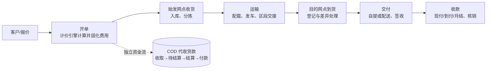

# 核心业务流程

> 依据 ROADMAP.md 第 6 节端到端验收场景整理。每个流程的自动化验收在其对应阶段完成。

## 主流程：开单到签收

## 流程要点

1. **运费与 COD 分离**：COD 收取、待结算、已结算和付款独立追踪，不计入物流运费收入。
2. **状态分离**：运单、货物、运输、交付、运费财务、COD 六类状态独立维护（见[术语表](glossary.md)）。
3. **历史可追溯**：运单事件、交接记录、财务流水均为追加式，关键状态变化记录操作人、网点、时间和前后状态。

## 端到端验收场景（MVP 前）

| 场景 | 内容 | 来源 |
| --- | --- | --- |
| A：现付直达 | 开单 → 计价 → 现付 → 收货 → 发车 → 到货 → 自提签收 | ROADMAP §6 |
| B：多段运输 | 广州—武汉—长沙方案，逐段发车、到货、交接，运单展示每段历史 | ROADMAP §6 |
| C：调拨差异 | 调拨发出 → 调入验收短少/破损 → 记录差异与责任网点，原始交接记录不可覆盖 | ROADMAP §6 |
| D：月结与部分收款 | 账单生成确认 → 两次付款分别核销 → 账单余额、客户余额、流水一致 | ROADMAP §6 |
| E：COD | 设置 COD → 交付时收款 → 发货人待结算余额 → 结算审批 → 付款 → 余额归零 | ROADMAP §6 |
